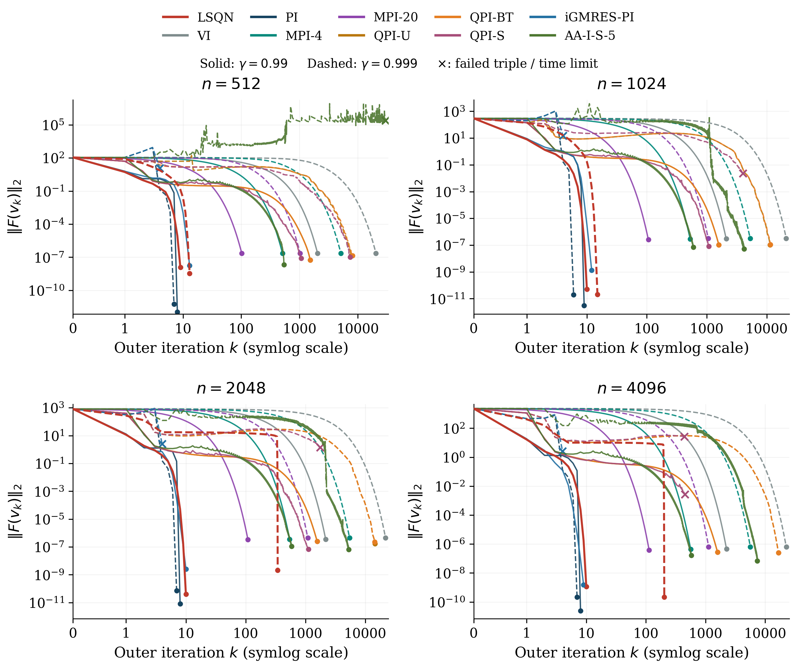
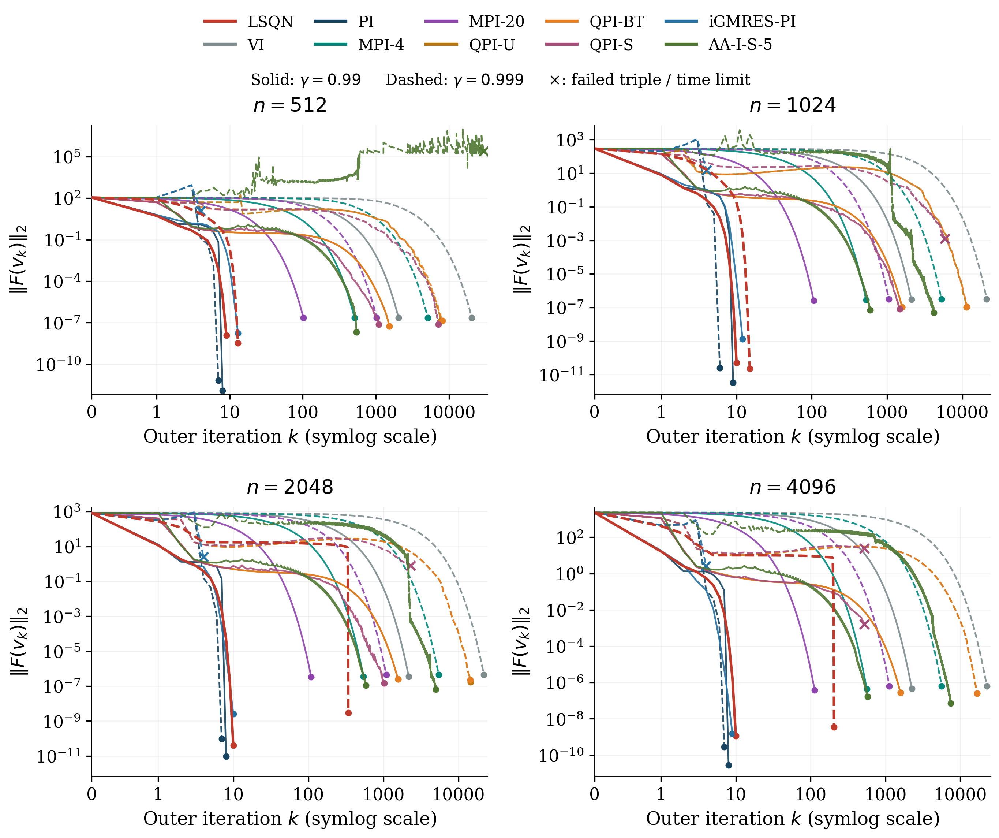
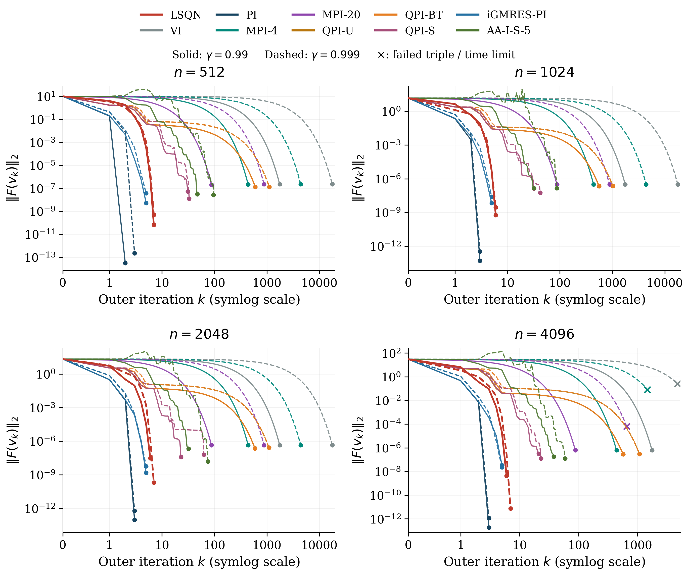
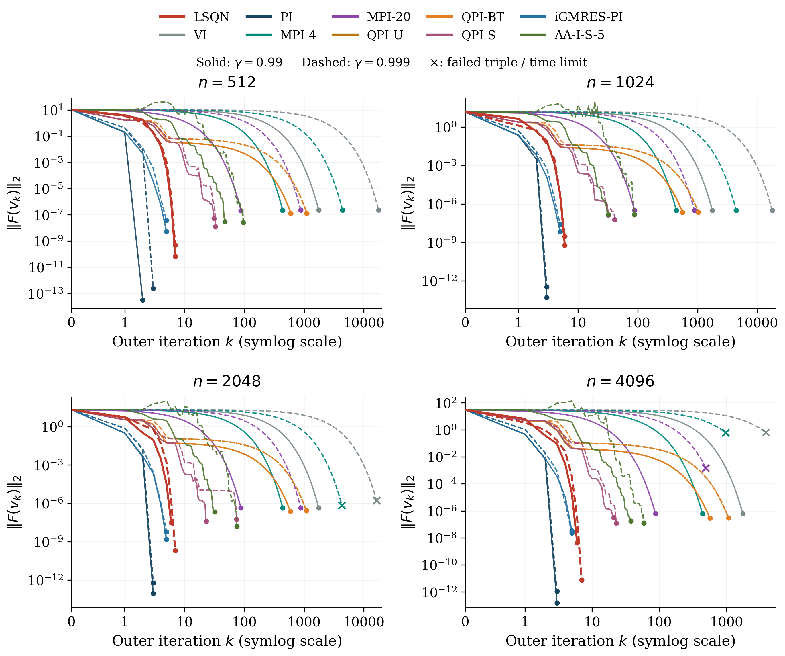
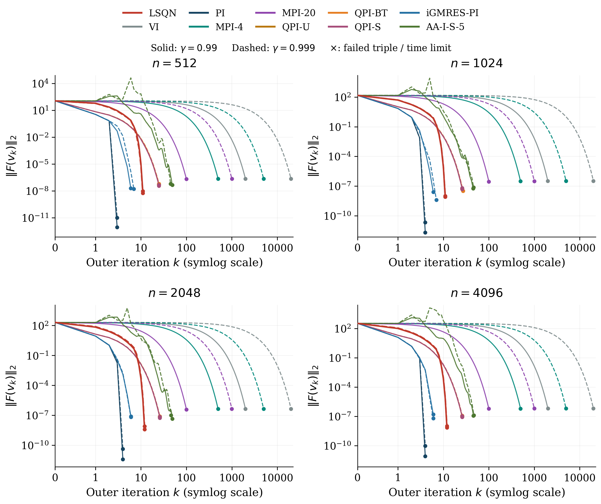
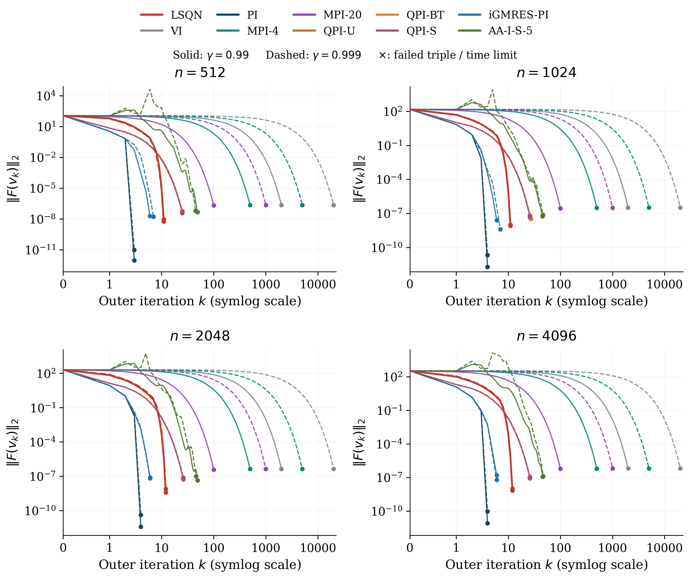
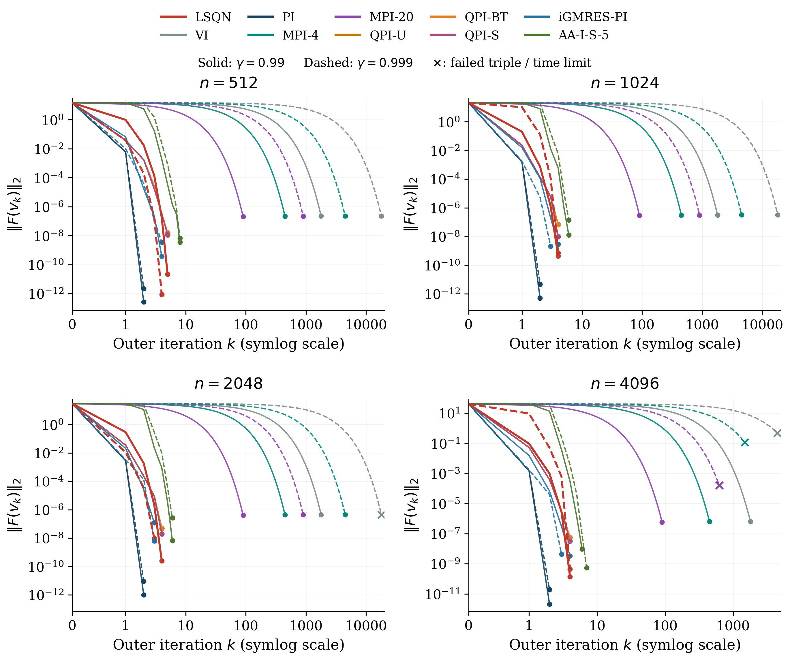
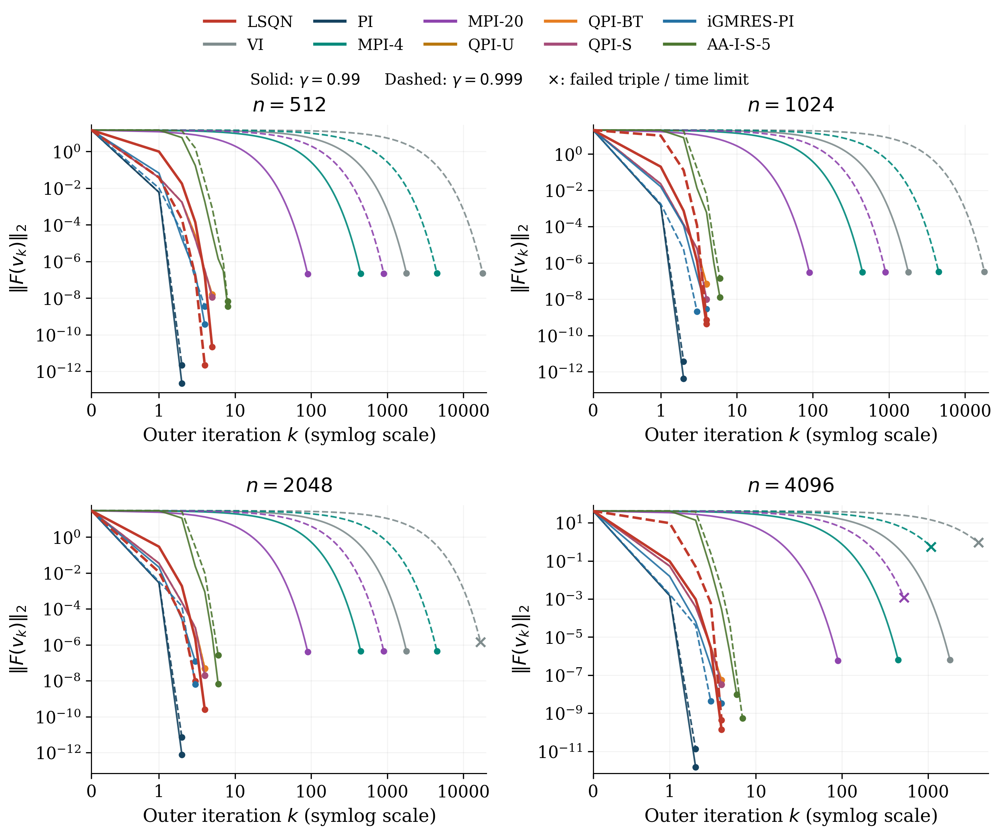
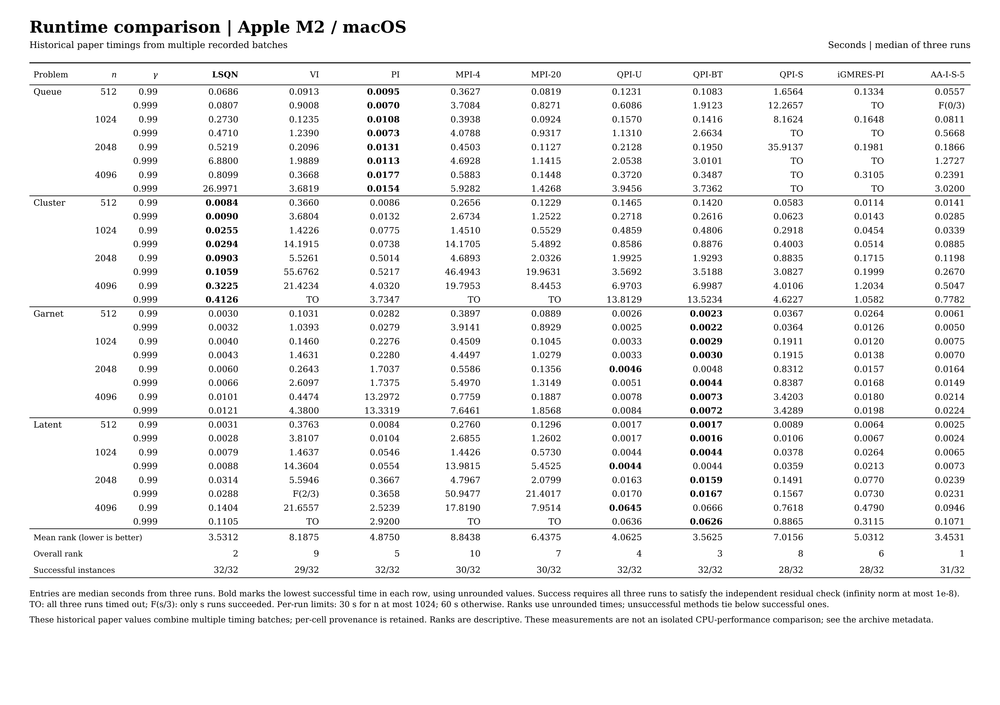
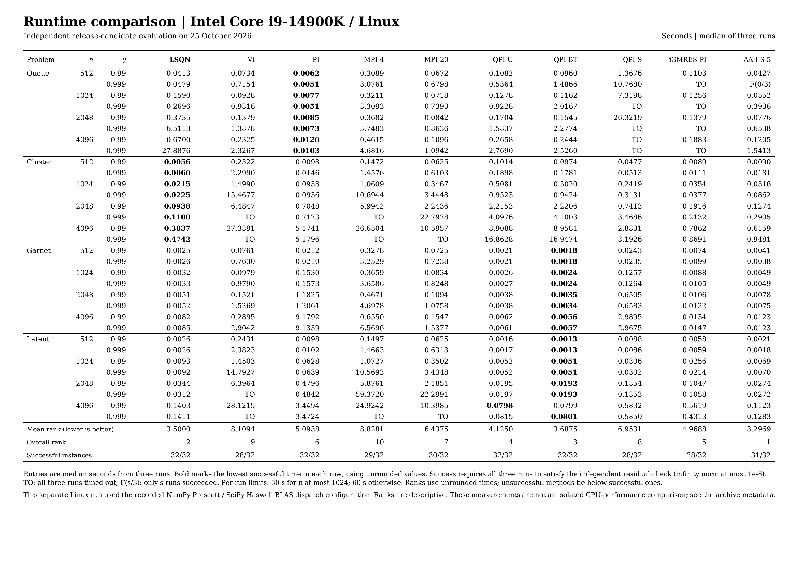

# LSQN

Code for *A Globally Convergent Line-Search Quasi-Newton Method for Discounted Markov Decision Processes*.

This public package contains the LSQN solver, seven runnable baselines, and the paper experiment suites. Archived results and settings are retained for all nine baselines used in the paper. The AA-I-S-5 and iGMRES-PI implementations are not distributed. The code runs on the CPU on Linux and macOS.

## Results on macOS and Linux

The paper's Apple M2/macOS measurements are compared with a separate Intel Core i9-14900K/Linux run. LSQN completed all 156 Linux solves and achieved the second-lowest mean runtime rank on both platforms. See the [full comparison](benchmarks/README.md) for numerical results, recorded environments, and provenance.

### Bellman residuals

The figures retain the paper's colors, line styles, and four-panel layout. Each curve is the median-runtime repetition; crosses mark unsuccessful triples. Corresponding panels use the same axis limits. Click a figure for its vector PDF.

These plots use the final runtime-table configurations on both hosts. The macOS plots are regenerated from those historical records, so they need not reproduce the paper's earlier figure-profile trajectories. The comparison documents portability; the recorded software environments and input differences are detailed in the [comparison notes](benchmarks/README.md#environment-and-comparison-limits).

| Apple M2 / macOS | Intel Core i9-14900K / Linux |
| :---: | :---: |
| **Controlled queue** | **Controlled queue** |
| [](benchmarks/figures/queue_macos.pdf) | [](benchmarks/figures/queue_linux.pdf) |
| **Nearly decomposable clustered chain** | **Nearly decomposable clustered chain** |
| [](benchmarks/figures/cluster_macos.pdf) | [](benchmarks/figures/cluster_linux.pdf) |
| **Sparse Garnet** | **Sparse Garnet** |
| [](benchmarks/figures/garnet_macos.pdf) | [](benchmarks/figures/garnet_linux.pdf) |
| **Dense latent-mixture model** | **Dense latent-mixture model** |
| [](benchmarks/figures/latent_macos.pdf) | [](benchmarks/figures/latent_linux.pdf) |

### Runtime

The tables use the paper's layout: seconds, median of three runs, fastest successful entry in bold, and all failures retained. Mean ranks are computed within each platform. Absolute times from the two hosts are descriptive, not a controlled CPU comparison.

**Apple M2 / macOS**

[](benchmarks/figures/runtime_macos.pdf)

**Intel Core i9-14900K / Linux**

[](benchmarks/figures/runtime_linux.pdf)

## Install and check

Use a separate Python 3.11 environment and a C compiler (`cc`, GCC, or Clang):

```bash
conda create -n lsqn-repro python=3.11 pip -y
conda run -n lsqn-repro python -m pip install -e .
conda run --no-capture-output -n lsqn-repro python scripts/prepare_backend.py
conda run --no-capture-output -n lsqn-repro python scripts/run_suite.py smoke --methods all
```

The smoke check runs the eight included methods on six small problems (48 solves) and independently verifies their solutions. CUDA and a GPU are not required. See [Linux instructions in Chinese](RUN_LINUX_ZH.md).

## Run the experiments

```bash
conda run --no-capture-output -n lsqn-repro python scripts/run_paper.py
```

This runs the main comparison with the eight included methods (768 solves), public benchmarks (24 LSQN solves), and scaling experiments (36 LSQN solves) in sequence, for 828 solves in total. Each execution creates a new results directory and a ZIP with numerical results, residual histories, timing summaries, and machine metadata. Existing results are never overwritten.

| Command after `python` | Scope |
| --- | --- |
| `scripts/run_suite.py main --methods all` | Four model families, four sizes, two discounts, eight included methods, three repetitions |
| `scripts/run_suite.py public` | Official FrozenLake, Taxi, and CliffWalking benchmarks |
| `scripts/run_suite.py scaling` | Six state counts and three seeds for each discount factor |
| `scripts/run_suite.py all` | All three suites with LSQN only |
| `scripts/run_paper.py --implementation curves` | Run the included methods with the LSQN profile used for the four residual figures |

Here, `--methods all` means all eight included methods. AA-I-S-5 and iGMRES-PI cannot be rerun from this package; their archived measurements remain in the figures and tables. New eight-method runs do not produce the paper's formal ten-method ranks, and archived measurements are not inserted into new runs. See [baseline records and settings](docs/BASELINE_RECORDS.md).

The default stopping tolerance is `1e-8` in the infinity norm, with one BLAS thread. All failed runs and timeouts are retained. Timings from different machines should be reported separately; floating-point differences can also affect iteration and query counts.

## Use the solver

```python
from lsqn import SolverOptions, solve

result = solve(mdp, options=SolverOptions(), v0=mdp.common_lower_bound())
print(result["converged"], result["residual"])
```

`mdp` is an `lsqn.MDP` with dense or CSR transition matrices. See [the complete example](examples/quickstart.py).

## Verify

Validation checks archived input hashes exactly. Regenerated inputs must have
the same structure and agree numerically within a small float64 tolerance;
the report includes their maximum absolute differences.

```bash
conda run -n lsqn-repro python -m unittest discover -s tests -v
conda run -n lsqn-repro python -m experiments.validate
conda run -n lsqn-repro python scripts/verify_manifest.py
python scripts/summarize_benchmarks.py --check
```

To regenerate the figures and tables from the archived records, install the
optional plotting dependencies and Poppler (`pdftoppm`), then run:

```bash
conda run -n lsqn-repro python -m pip install -e '.[plots]'
conda run -n lsqn-repro python scripts/plot_benchmarks.py
conda run -n lsqn-repro python scripts/plot_runtime_tables.py
```

These commands regenerate the full ten-method comparison from the archived records, including AA-I-S-5 and iGMRES-PI, without running either omitted baseline. Implementation provenance and historical checks are recorded in the technical notes and [validation notes](validation/README.md).

## Citation

Please cite the associated paper when using LSQN. Author and citation metadata are provided in [CITATION.cff](CITATION.cff).

## License and attribution

The authors' code is licensed under [MIT](LICENSE). Third-party notices, including the Gymnasium license, are listed in [THIRD_PARTY_NOTICES.md](THIRD_PARTY_NOTICES.md). The two omitted baseline implementations have not been replaced or relicensed; their archived results, settings, and provenance are retained for comparison.

